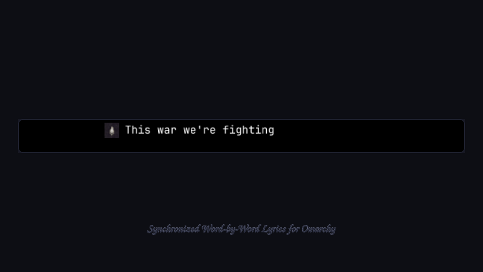

# Omarchy Lyrics Plugin

Synchronized karaoke & word-by-word lyrics bar widget for the [Omarchy](https://omarchy.org) Quattro desktop environment.



## Features

- 🎵 **Word-by-word Syllable Reveal**: Smooth word-by-word animations with rhythmic beat bounce on every syllable.
- ⚡ **Seamless Studio Sync Upgrade (NetEase YRC)**: Fast instant start from line-synced lyrics with automatic background upgrade to syllable-level YRC studio sync.
- 🌐 **Multi-Provider Search Engine**:
  - [LRCLIB](https://lrclib.net/) (Exact match & fuzzy catalog search)
  - [NetEase Cloud Music](https://music.163.com/) (YRC syllable-level sync & LRC)
  - [LRC.CX](https://api.lrc.cx/) (Apple Music & Asian tracks mirror)
  - [Kugou](https://kugou.com/) (KRC decoders)
- 🧠 **Fuzzy Match Engine**:
  - Levenshtein ratio distance matching
  - Latin ⇄ Cyrillic phonetic transliteration (`translit`)
  - Automatic noise stripping (`(Official Video)`, `[MV]`, `feat.`, emojis, timestamps)
  - **Tempo-Aware Time Scaling**: Automatically stretches timestamps for *Sped up*, *Slowed*, and *Nightcore* versions (`scale = length / duration`)
- ⏱️ **Per-Track Sync Offset Calibration**:
  - Adjust timing on the fly with `Shift + Mouse Wheel`
  - Saves calibration specifically for each individual song in `~/.cache/omarchy/lyrics/track_offsets.json`
- 🖼️ **Album Art Thumbnail**: Displays a crisp, rounded mini album cover directly in the bar alongside the lyrics.
- 📜 **Full View Popup Card**:
  - Displays full synchronized lyrics list
  - Click any line to seek directly to that timestamp in your player
  - Displays provider source badge (`via NetEase (YRC)`, `via lrclib`, etc.)
  - Interactive offset controls (`-50ms`, `+50ms`, `Reset`)

---

## Installation

### From GitHub (via Omarchy CLI)

```bash
omarchy plugin add https://github.com/Gob7912/omarchy-lyrics --enable
```

Then restart your shell to apply changes:

```bash
omarchy-restart-shell
```

### Manual Installation (Development)

Clone this repository directly into your Omarchy plugins folder:

```bash
git clone https://github.com/Gob7912/omarchy-lyrics.git ~/.config/omarchy/plugins/lyrics
omarchy plugin enable gob7912.lyrics
omarchy-restart-shell
```

---

## Usage & Controls

| Action | Control | Description |
| :--- | :--- | :--- |
| **Open Popup** | `Left Click` | Open full synchronized lyrics view |
| **Play / Pause** | `Middle Click` | Toggle playback of the current MPRIS media player |
| **Next Track** | `Right Click` | Skip to the next track |
| **Prev / Next** | `Scroll Wheel` | Scroll wheel over the widget skips track |
| **Calibrate Sync** | `Shift + Scroll Wheel` | Adjust lyrics timing delay/advance by `±50 ms` (saved per track!) |
| **Seek to Line** | `Left Click (in popup)` | Jump directly to that timestamp in the song |

---

## Removal

To uninstall the plugin:

```bash
omarchy plugin remove gob7912.lyrics --yes
omarchy-restart-shell
```

Or remove manually if installed via git:

```bash
rm -rf ~/.config/omarchy/plugins/lyrics
omarchy-restart-shell
```

---

## Dependencies

- **Omarchy Quattro** (with Quickshell)
- Standard tools (already present in Omarchy):
  - `curl`
  - `python3` (standard library only, zero pip dependencies)
- Any MPRIS-compatible player (Spotify, Firefox, Chromium, Apple Music, mpv, etc.)

---

## License

This project is licensed under the [MIT License](LICENSE).
